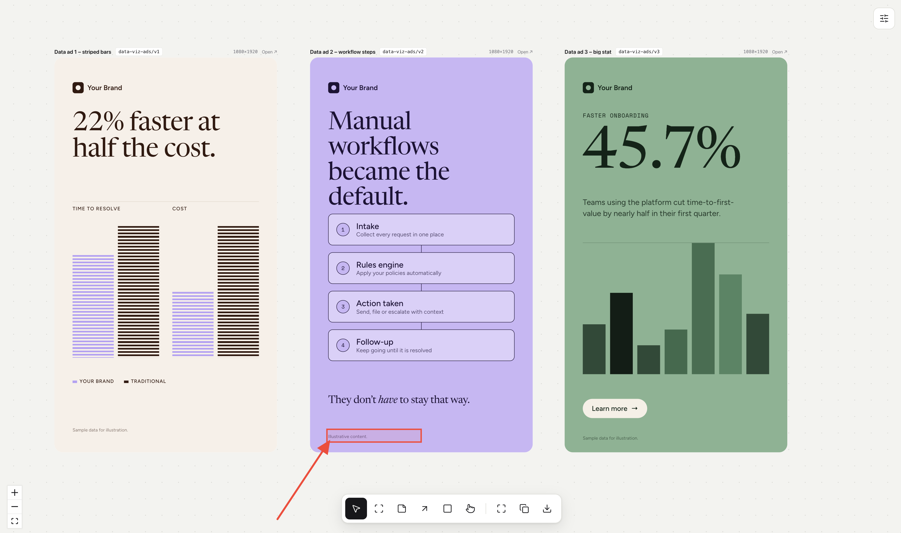

<div align="center">

# Claude Design Canvas

**An infinite design canvas you drive from the terminal.**<br>
Ask Claude Code for designs, review them side by side, draw on them, and reprompt.


<br>



</div>

<br>

## Why

Chat is a poor way to give design feedback. This repo turns a folder of HTML files into a canvas: every file in `designs/`
is a node, Claude writes them, and you annotate them the way you would in a design tool. Your arrows and rectangles are
resolved to the real elements underneath, so you can paste *exactly* where something should change.

- **Real HTML, not images.** Every design is a self-contained file you can open, edit, ship or share.
- **Draw to reprompt.** Arrows, rectangles and notes copy into Claude Code as precise, section-level instructions.
- **Brand-aware.** Point it at a website or PDF and it pulls logo, colors, fonts, typography and tone of voice into `brand/`.
- **Matches production.** Link your real codebase and Storybook so product UI reuses your actual components and tokens.
- **A boilerplate.** Clone it for every new project. Everything project-specific lives in `brand/`, `designs/` and `canvas.json`.

## Quick start

Requires Node 20+ and [Claude Code](https://claude.com/claude-code).

```sh
git clone https://github.com/tommyjepsen/claude-design-canvas.git my-project
cd my-project
npm install
npm run dev          # canvas at http://localhost:4747
claude               # in a second terminal, then: "set up this project"
```

The `setup-project` skill asks for a brand source (website URL, PDF, or pasted guidelines) and optionally your production
codebase, then fills `brand/`. After that, just ask:

```text
generate 6 pinterest static ads
redesign the settings page using our components
3 more variants of pinterest-ads/v2, see my notes
```

Designs appear on the canvas live as Claude writes them.

## Review loop

1. **Generate.** Claude writes `designs/<set>/<name>.html` and places the nodes on the canvas.
2. **Annotate.** Draw an arrow at the thing to change, a rectangle around a spacing problem, drop a note with the instruction.
3. **Copy.** Press `C`. You get something like:

   ```text
   Canvas annotations (x/y/w/h are design pixels from the top-left of that design):
   1. Arrow: from note "too tight" -> pointing at pricing/v1#footnote ("Illustrative content.") at (98, 1859)
   2. Rectangle on pricing/v1: x=82 y=1808 w=457 h=62; inside footer; overlaps footnote; next to kicker
   ```

4. **Paste into Claude Code.** It knows which file, which section and how far to move things.

## Canvas controls

| Key | Tool | What it does |
| --- | --- | --- |
| `V` | Select | Drag nodes, box-select, scroll to pan, pinch / `Ctrl`+scroll to zoom |
| `P` | Pick element | Hover a section inside a design, click to copy a ref like `pinterest-ads/v2#headline` |
| `N` | Note | Click to drop a text note |
| `A` | Arrow | Drag anywhere to point at a spot |
| `R` | Rectangle | Drag to highlight an area |
| `I` | Interact | Use the prototype itself (clicks, scroll) |
| `L` | Layers | Open the left panel: every design and its `data-section` layers. Hover to highlight on the canvas, click to copy its ref |
| `F` | Fit | Fit everything in view |
| `C` | Copy | Copy annotations as a prompt-ready block (selected ones, or all if nothing is selected) |
| `S` | Share | Download the selected design(s) as a standalone `.html` |
| `Cmd/Ctrl+Z` | Undo / redo | `Shift` to redo. Covers moves, notes, arrows and rectangles |

Arrows and rectangles are free-form: click to select, drag to move, `Backspace` to delete, `Esc` to leave a drawing tool.
The settings button (top right) rounds the frame corners for presentation. Click a node's id chip to copy its id. Right-click a frame for Copy HTML (self-contained), copy id / file path, download and open in a new tab.

**Share** inlines the brand stylesheet and local images or fonts, so the downloaded file opens anywhere. Google Fonts stay
as links and need an internet connection.

## Skills

These live in `.claude/skills/` and ship with the repo.

| Skill | Use it to |
| --- | --- |
| `setup-project` | First run on a fresh clone: brand and codebase onboarding, installs and starts the canvas |
| `brand-from-url` | Extract logo, colors, fonts, typography and voice from a website into `brand/` |
| `brand-from-pdf` | Same, from a PDF such as a brand guidelines document or pitch deck |
| `link-codebase` | Record where your design system, tokens, components and Storybook live in `brand/codebase.md` |

## Project structure

```text
.
├── designs/            # one HTML file per canvas node (designs/<set>/<name>.html)
├── brand/              # brand.md, tokens.css, assets/, codebase.md  (per project)
├── canvas.json         # positions, notes, arrows and rectangles    (per project)
├── templates/          # starting points for new designs
├── scripts/            # layout, state and archive helpers
├── src/                # the canvas app (React Flow)
├── examples/           # filled-in reference setups
├── docs/               # README assets
└── .claude/skills/     # skills that ship with the boilerplate
```

| Command | What it does |
| --- | --- |
| `npm run dev` | Start the canvas on port 4747 |
| `npm run state` | Print designs, notes and annotations (what Claude reads) |
| `npm run layout` | Place new designs on the canvas (rows for a fresh batch, columns for iterations) |
| `npm run archive` | Move `designs/` and `canvas.json` into `archive/<timestamp>/` for a clean slate |

## Design file format

Each design is plain HTML with a size declared in the head:

```html
<meta name="canvas:width" content="1080">
<meta name="canvas:height" content="1920">
<link rel="stylesheet" href="/brand/tokens.css">
```

Blocks you want to point at get a `data-section` attribute (`headline`, `cta`, `hero-visual`, ...). That is what makes
annotations and **Pick element** resolve to named sections. See `CLAUDE.md` for the full rules Claude follows.

## Contributing

Issues and pull requests are welcome. Run `npm run dev` and open the canvas to try changes; there is no build step for designs.
